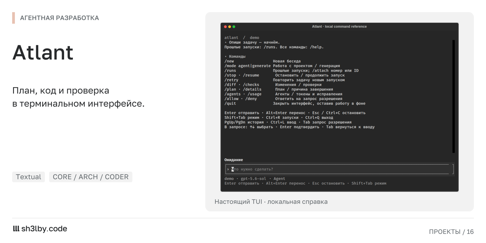
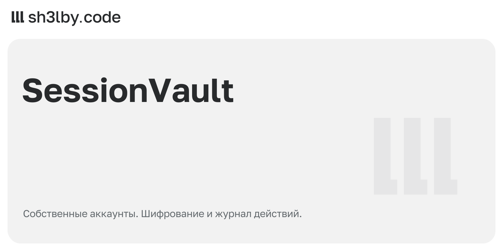
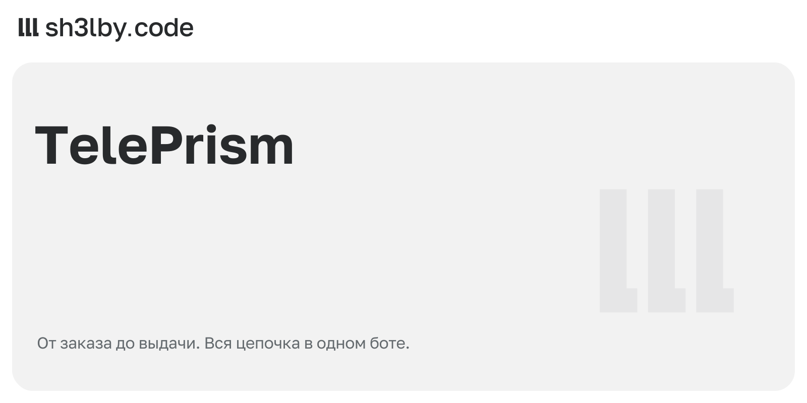
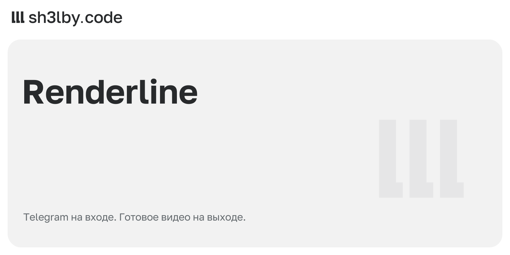

# sh3lby.code

Python backend, Telegram products and self-hosted infrastructure.

I build APIs, bots, developer tools and Minecraft server systems.

<table>
<tr><td width="50%"><a href="https://github.com/proger-exe/polis-map"> Polis Map</a></td><td width="50%"><a href="https://github.com/proger-exe/atlant"> Atlant</a></td></tr>
<tr><td width="50%"><a href="https://github.com/proger-exe/sessionvault"> SessionVault</a></td><td width="50%"><a href="https://github.com/proger-exe/teleprism"> TelePrism</a></td></tr>
<tr><td width="50%"><a href="https://github.com/proger-exe/renderline"> Renderline</a></td><td width="50%"><a href="https://github.com/proger-exe/ledgerline"> Ledgerline</a></td></tr>
</table>

[Все 25 карточек проектов](portfolio/README.md)

**Stack:** Python · FastAPI · aiogram · PostgreSQL · Redis · Docker · Linux · React · TypeScript · Java / Paper.

[Portfolio](https://sh3lbyx.ru) · [Repositories](https://github.com/proger-exe?tab=repositories)

Demo status: Polis Map is live. Ledgerline and Renderline bot demos are pending;
Ledgerline is configured for testnet. These repositories include prototypes and
have project-specific verification notes.
