# Проекты sh3lby.code

Карточки проектов. Режим съёмки интерфейсов указан под изображениями.

## Polis Map

[Репозиторий](https://github.com/proger-exe/polis-map)

Скриншот работающего веб-демо Polis Map.

## MineGate

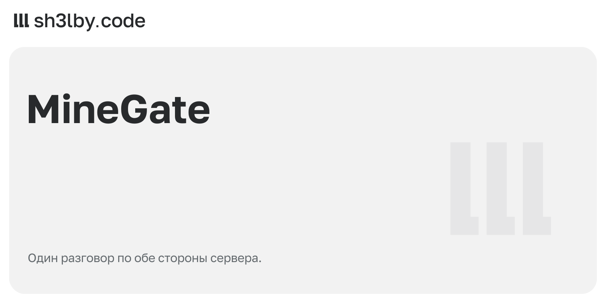

[Репозиторий](https://github.com/proger-exe/minegate)

## AntiIllegal Enchants

[Репозиторий](https://github.com/proger-exe/anti-illegal-enchants)

## Boat Race

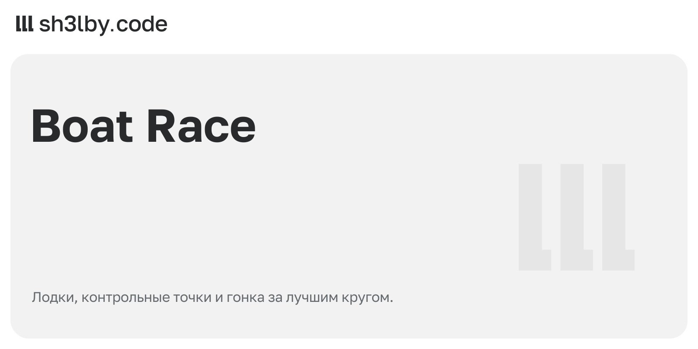

[Репозиторий](https://github.com/proger-exe/boat-race)

## ungit

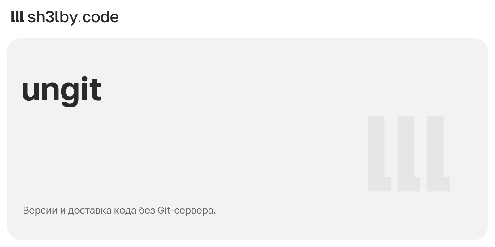

[Репозиторий](https://github.com/proger-exe/ungit)

## Jarvis

[Репозиторий](https://github.com/proger-exe/jarvis)

## Navidrome Bot

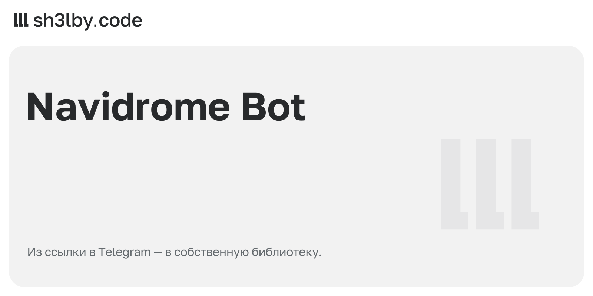

[Репозиторий](https://github.com/proger-exe/navidrome-bot)

## Ledgerline

[Репозиторий](https://github.com/proger-exe/ledgerline)

Интерфейс с вымышленными данными, без подключения к Telegram и платёжной сети.

## AI Trainer

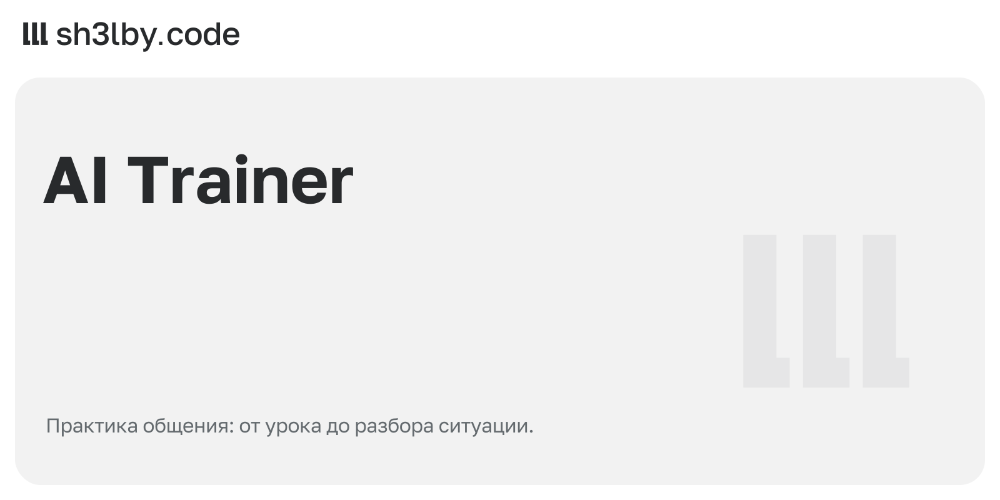

[Репозиторий](https://github.com/proger-exe/ai-trainer)

## Renderline

[Репозиторий](https://github.com/proger-exe/renderline)

## SessionVault

[Репозиторий](https://github.com/proger-exe/sessionvault)

## Consulidate

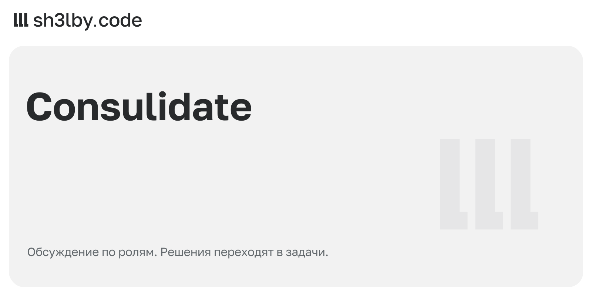

[Репозиторий](https://github.com/proger-exe/consulidate)

## Codex Gateway

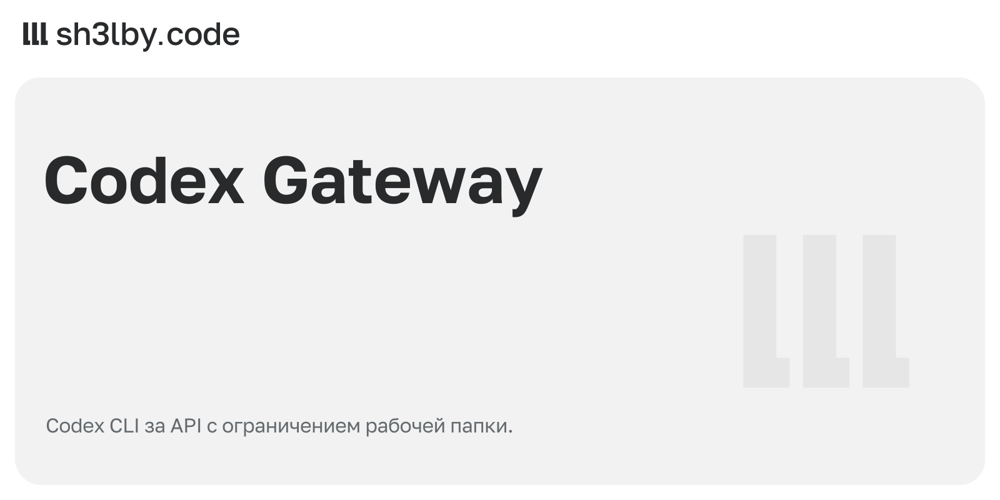

[Репозиторий](https://github.com/proger-exe/codex-gateway)

## TelePrism

[Репозиторий](https://github.com/proger-exe/teleprism)

## CodexCode

[Репозиторий](https://github.com/proger-exe/codexcode)

Локальное превью renderer: пустой проект, без запуска Codex, терминала и LSP.

## Atlant

[Репозиторий](https://github.com/proger-exe/atlant)

Настоящий TUI с локальной справкой /help, без обращения к модели.

## CraftCore API

[Репозиторий](https://github.com/proger-exe/craftcore-api)

## CraftSocial

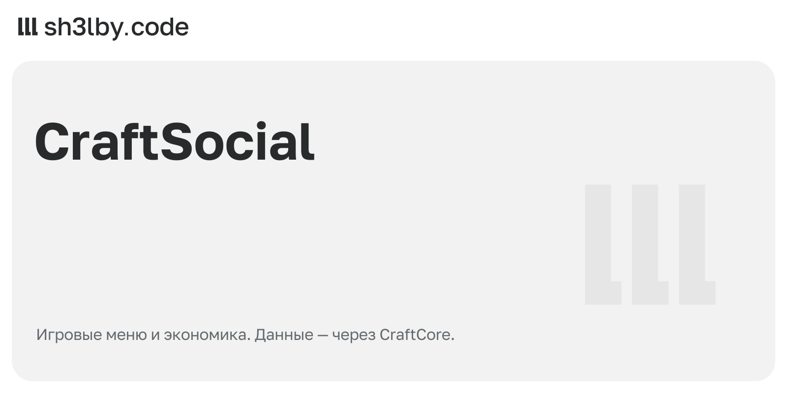

[Репозиторий](https://github.com/proger-exe/craftsocial)

## COS

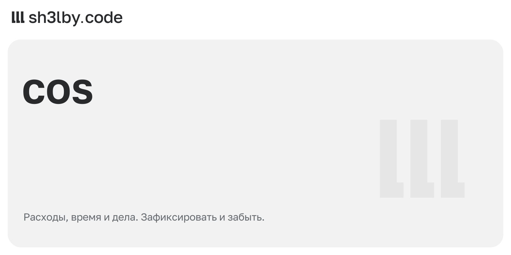

[Репозиторий](https://github.com/proger-exe/cos-bot)

## GateKeeper

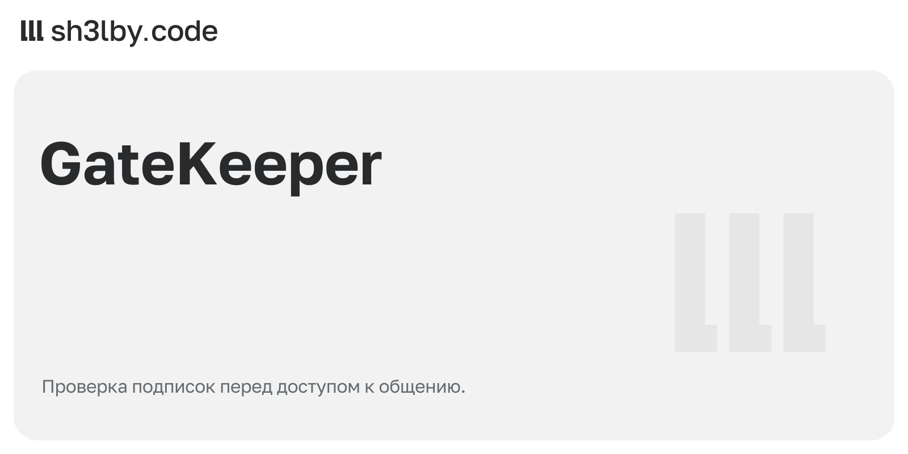

[Репозиторий](https://github.com/proger-exe/gatekeeper-bot)

## EMNPC

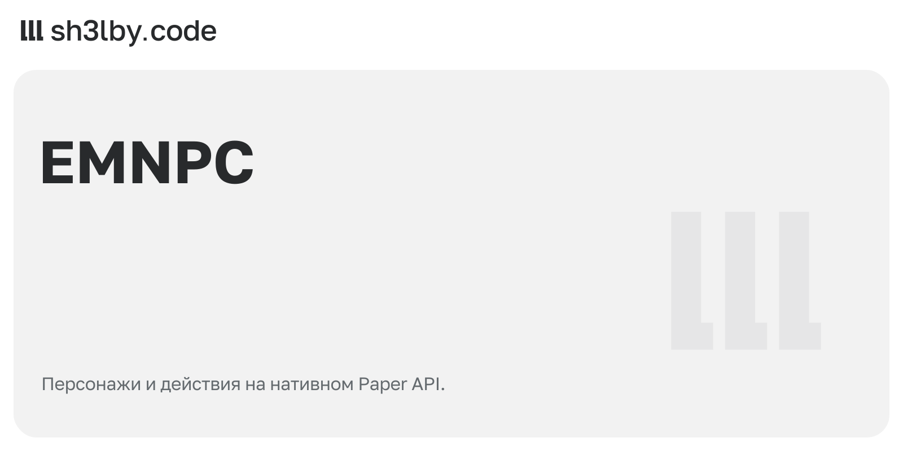

## FalseEnd

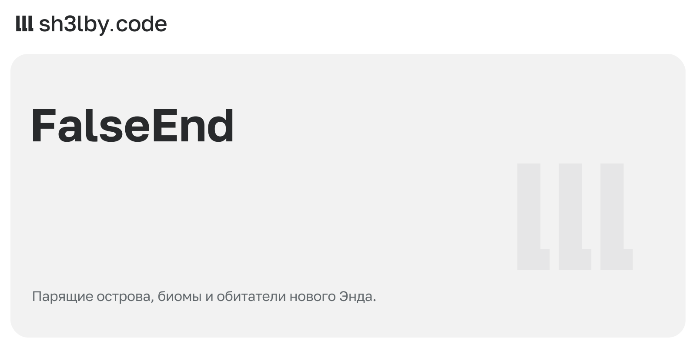

## LootDrop

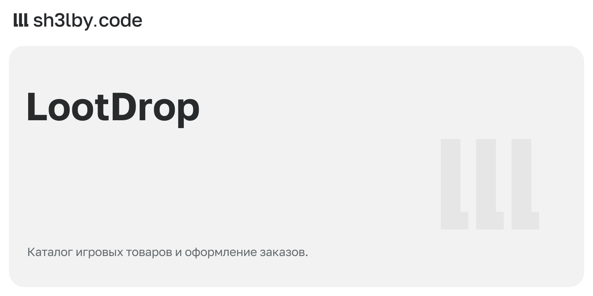

[Репозиторий](https://github.com/proger-exe/lootdrop)

## Orbit Cabinet

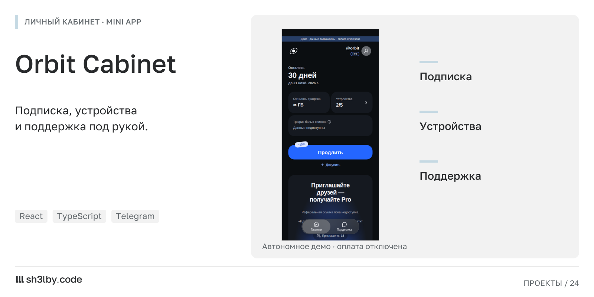

Автономное демо с вымышленными данными и отключённой оплатой.

## MineIntel

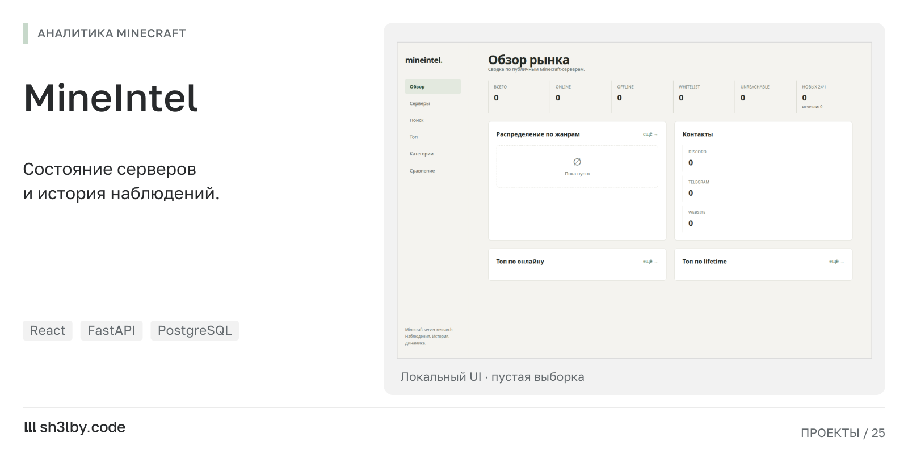

Локальный UI с пустыми данными; backend и сканер не запускались.
